# Poly Haven: Forest & Woodland HDRIs

**59 assets from [Poly Haven](https://polyhaven.com), dedicated to the public domain under [CC0](https://polyhaven.com/license).** Use them in any game, free or paid, and change them however you like; no credit is needed.

HDRI skies and environments as 1K and 2K Radiance `.hdr` images, for lighting and backgrounds. 541.2 MB in all.

This is a copy kept by [zuujis-cc0](https://github.com/zuujis-cc0) so game makers can take single files from GitHub. It is not made by or affiliated with Poly Haven: the originals, in more formats and higher resolutions, are on [polyhaven.com](https://polyhaven.com). If they help you, consider [supporting Poly Haven](https://www.patreon.com/polyhaven/overview).

Every file is listed in [MANIFEST.tsv](MANIFEST.tsv) with its size and SHA-256. More free assets: [the collection](https://github.com/zuujis-cc0/free-game-assets#readme).

| | | | |
| :-: | :-: | :-: | :-: |
| <a href="autumn_crossing">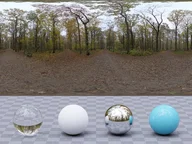</a> <b><a href="autumn_crossing">Autumn Crossing</a></b> by Greg Zaal · <a href="https://polyhaven.com/a/autumn_crossing">source</a> | <a href="autumn_forest_01">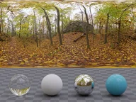</a> <b><a href="autumn_forest_01">Autumn Forest 01</a></b> by Andreas Mischok · <a href="https://polyhaven.com/a/autumn_forest_01">source</a> | <a href="autumn_forest_02">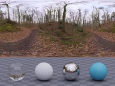</a> <b><a href="autumn_forest_02">Autumn Forest 02</a></b> by Andreas Mischok · <a href="https://polyhaven.com/a/autumn_forest_02">source</a> | <a href="autumn_forest_03">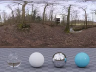</a> <b><a href="autumn_forest_03">Autumn Forest 03</a></b> by Andreas Mischok · <a href="https://polyhaven.com/a/autumn_forest_03">source</a> |
| <a href="autumn_forest_04">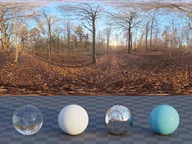</a> <b><a href="autumn_forest_04">Autumn Forest 04</a></b> by Alexander Scholten · <a href="https://polyhaven.com/a/autumn_forest_04">source</a> | <a href="autumn_ground">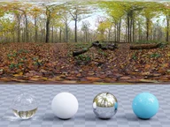</a> <b><a href="autumn_ground">Autumn Ground</a></b> by Greg Zaal · <a href="https://polyhaven.com/a/autumn_ground">source</a> | <a href="bamboo_tunnel">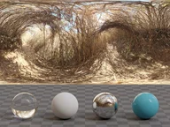</a> <b><a href="bamboo_tunnel">Bamboo Tunnel</a></b> by Dimitrios Savva, Jarod Guest · <a href="https://polyhaven.com/a/bamboo_tunnel">source</a> | <a href="birchwood">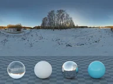</a> <b><a href="birchwood">Birchwood</a></b> by Sergej Majboroda · <a href="https://polyhaven.com/a/birchwood">source</a> |
| <a href="blaubeuren_outskirts">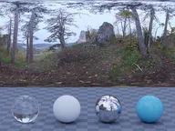</a> <b><a href="blaubeuren_outskirts">Blaubeuren Outskirts</a></b> by Andreas Mischok · <a href="https://polyhaven.com/a/blaubeuren_outskirts">source</a> | <a href="blue_grotto">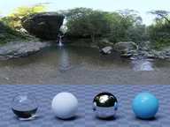</a> <b><a href="blue_grotto">Blue Grotto</a></b> by Greg Zaal · <a href="https://polyhaven.com/a/blue_grotto">source</a> | <a href="cave_wall">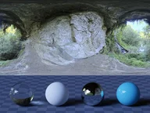</a> <b><a href="cave_wall">Cave Wall</a></b> by Greg Zaal · <a href="https://polyhaven.com/a/cave_wall">source</a> | <a href="dark_autumn_forest">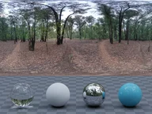</a> <b><a href="dark_autumn_forest">Dark Autumn Forest</a></b> by Dimitrios Savva, Greg Zaal · <a href="https://polyhaven.com/a/dark_autumn_forest">source</a> |
| <a href="eilenriede_labyrinth">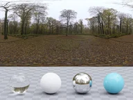</a> <b><a href="eilenriede_labyrinth">Eilenriede Labyrinth</a></b> by Greg Zaal · <a href="https://polyhaven.com/a/eilenriede_labyrinth">source</a> | <a href="epping_forest_01">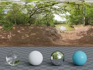</a> <b><a href="epping_forest_01">Epping Forest 01</a></b> by Andreas Mischok · <a href="https://polyhaven.com/a/epping_forest_01">source</a> | <a href="epping_forest_02">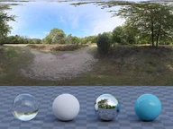</a> <b><a href="epping_forest_02">Epping Forest 02</a></b> by Andreas Mischok · <a href="https://polyhaven.com/a/epping_forest_02">source</a> | <a href="felsenlabyrinth">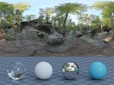</a> <b><a href="felsenlabyrinth">Felsenlabyrinth</a></b> by Andreas Mischok · <a href="https://polyhaven.com/a/felsenlabyrinth">source</a> |
| <a href="forest_cave">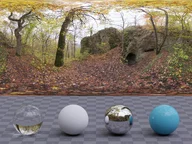</a> <b><a href="forest_cave">Forest Cave</a></b> by Andreas Mischok · <a href="https://polyhaven.com/a/forest_cave">source</a> | <a href="forest_grove">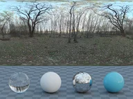</a> <b><a href="forest_grove">Forest Grove</a></b> by Dimitrios Savva, Jarod Guest · <a href="https://polyhaven.com/a/forest_grove">source</a> | <a href="forest_slope">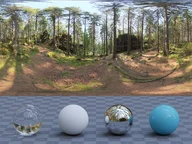</a> <b><a href="forest_slope">Forest Slope</a></b> by Andreas Mischok · <a href="https://polyhaven.com/a/forest_slope">source</a> | <a href="green_sanctuary">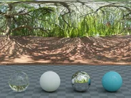</a> <b><a href="green_sanctuary">Green Sanctuary</a></b> by Andreas Mischok · <a href="https://polyhaven.com/a/green_sanctuary">source</a> |
| <a href="gum_trees">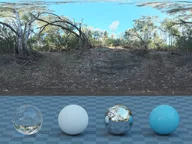</a> <b><a href="gum_trees">Gum Trees</a></b> by Dimitrios Savva, Jarod Guest · <a href="https://polyhaven.com/a/gum_trees">source</a> | <a href="herkulessaulen">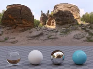</a> <b><a href="herkulessaulen">Herkulessäulen</a></b> by Andreas Mischok · <a href="https://polyhaven.com/a/herkulessaulen">source</a> | <a href="hikers_cave">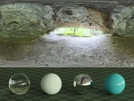</a> <b><a href="hikers_cave">Hiker's Cave</a></b> by Greg Zaal · <a href="https://polyhaven.com/a/hikers_cave">source</a> | <a href="hochsal_forest">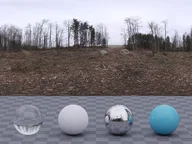</a> <b><a href="hochsal_forest">Hochsal Forest</a></b> by Adrian Kubasa · <a href="https://polyhaven.com/a/hochsal_forest">source</a> |
| <a href="je_gray_02">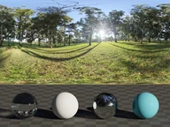</a> <b><a href="je_gray_02">J&E Gray 02</a></b> by Greg Zaal · <a href="https://polyhaven.com/a/je_gray_02">source</a> | <a href="lauter_waterfall">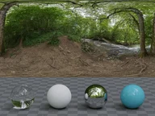</a> <b><a href="lauter_waterfall">Lauter Waterfall</a></b> by Andreas Mischok · <a href="https://polyhaven.com/a/lauter_waterfall">source</a> | <a href="lush_dirt_path">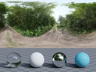</a> <b><a href="lush_dirt_path">Lush Dirt Path</a></b> by Alexander Scholten · <a href="https://polyhaven.com/a/lush_dirt_path">source</a> | <a href="meadow">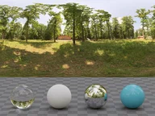</a> <b><a href="meadow">Meadow</a></b> by Sergej Majboroda · <a href="https://polyhaven.com/a/meadow">source</a> |
| <a href="meadow_2">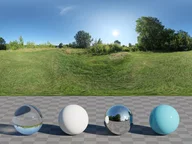</a> <b><a href="meadow_2">Meadow 2</a></b> by Sergej Majboroda · <a href="https://polyhaven.com/a/meadow_2">source</a> | <a href="missile_launch_facility_02">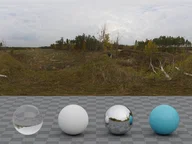</a> <b><a href="missile_launch_facility_02">Missile Launch Facility 02</a></b> by Sergej Majboroda · <a href="https://polyhaven.com/a/missile_launch_facility_02">source</a> | <a href="missile_launch_facility_03">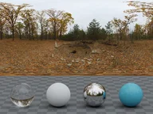</a> <b><a href="missile_launch_facility_03">Missile Launch Facility 03</a></b> by Sergej Majboroda · <a href="https://polyhaven.com/a/missile_launch_facility_03">source</a> | <a href="misty_pines">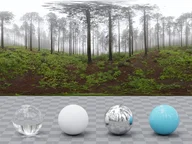</a> <b><a href="misty_pines">Misty Pines</a></b> by Greg Zaal · <a href="https://polyhaven.com/a/misty_pines">source</a> |
| <a href="monks_forest">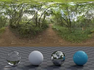</a> <b><a href="monks_forest">Monk's forest</a></b> by Greg Zaal · <a href="https://polyhaven.com/a/monks_forest">source</a> | <a href="mossy_forest">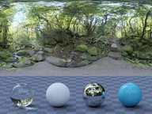</a> <b><a href="mossy_forest">Mossy Forest</a></b> by Greg Zaal · <a href="https://polyhaven.com/a/mossy_forest">source</a> | <a href="moulton_falls_train_tunnel_east">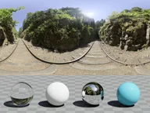</a> <b><a href="moulton_falls_train_tunnel_east">Moulton Falls Train Tunnel East</a></b> by Philip Modin · <a href="https://polyhaven.com/a/moulton_falls_train_tunnel_east">source</a> | <a href="moulton_station_train_tunnel_west">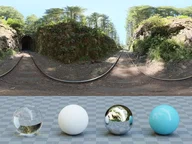</a> <b><a href="moulton_station_train_tunnel_west">Moulton Station Train Tunnel West</a></b> by Philip Modin · <a href="https://polyhaven.com/a/moulton_station_train_tunnel_west">source</a> |
| <a href="muddy_autumn_forest">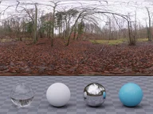</a> <b><a href="muddy_autumn_forest">Muddy Autumn Forest</a></b> by Andreas Mischok · <a href="https://polyhaven.com/a/muddy_autumn_forest">source</a> | <a href="nature_reserve_forest">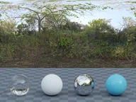</a> <b><a href="nature_reserve_forest">Nature Reserve Forest</a></b> by Dimitrios Savva, Jarod Guest · <a href="https://polyhaven.com/a/nature_reserve_forest">source</a> | <a href="niederwihl_forest">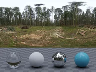</a> <b><a href="niederwihl_forest">Niederwihl Forest</a></b> by Adrian Kubasa · <a href="https://polyhaven.com/a/niederwihl_forest">source</a> | <a href="pathway_morning">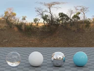</a> <b><a href="pathway_morning">Pathway Morning</a></b> by Dimitrios Savva, Jarod Guest · <a href="https://polyhaven.com/a/pathway_morning">source</a> |
| <a href="phalzer_forest_01">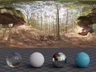</a> <b><a href="phalzer_forest_01">Pfälzer Forest 01</a></b> by Andreas Mischok · <a href="https://polyhaven.com/a/phalzer_forest_01">source</a> | <a href="rainforest_trail">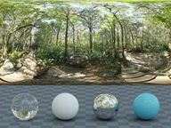</a> <b><a href="rainforest_trail">Rainforest Trail</a></b> by Dimitrios Savva, Jarod Guest · <a href="https://polyhaven.com/a/rainforest_trail">source</a> | <a href="river_walk_1">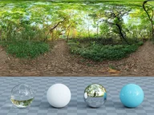</a> <b><a href="river_walk_1">River Walk 1</a></b> by Greg Zaal · <a href="https://polyhaven.com/a/river_walk_1">source</a> | <a href="river_walk_2">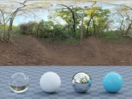</a> <b><a href="river_walk_2">River Walk 2</a></b> by Greg Zaal · <a href="https://polyhaven.com/a/river_walk_2">source</a> |
| <a href="schachen_forest">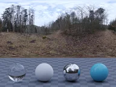</a> <b><a href="schachen_forest">Schachen Forest</a></b> by Adrian Kubasa · <a href="https://polyhaven.com/a/schachen_forest">source</a> | <a href="shady_patch">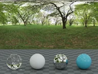</a> <b><a href="shady_patch">Shady Patch</a></b> by Greg Zaal · <a href="https://polyhaven.com/a/shady_patch">source</a> | <a href="skukuza_golf">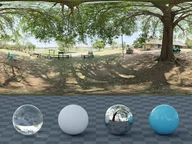</a> <b><a href="skukuza_golf">Skukuza Golf</a></b> by Greg Zaal · <a href="https://polyhaven.com/a/skukuza_golf">source</a> | <a href="small_cave">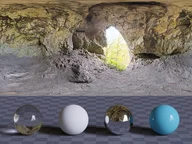</a> <b><a href="small_cave">Small Cave</a></b> by Andreas Mischok · <a href="https://polyhaven.com/a/small_cave">source</a> |
| <a href="snowy_forest">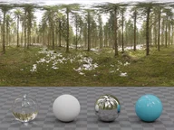</a> <b><a href="snowy_forest">Snowy Forest</a></b> by Adrian Kubasa · <a href="https://polyhaven.com/a/snowy_forest">source</a> | <a href="snowy_forest_path_01">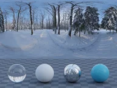</a> <b><a href="snowy_forest_path_01">Snowy Forest Path 01</a></b> by Oliksiy Yakovlyev · <a href="https://polyhaven.com/a/snowy_forest_path_01">source</a> |  <b><a href="snowy_forest_path_02">Snowy Forest Path 02</a></b> by Oliksiy Yakovlyev · <a href="https://polyhaven.com/a/snowy_forest_path_02">source</a> |  <b><a href="spooky_bamboo_morning">Spooky Bamboo Morning</a></b> by Dimitrios Savva, Jarod Guest · <a href="https://polyhaven.com/a/spooky_bamboo_morning">source</a> |
|  <b><a href="stream">Stream</a></b> by Greg Zaal · <a href="https://polyhaven.com/a/stream">source</a> |  <b><a href="sunset_forest">Sunset Forest</a></b> by Andreas Mischok · <a href="https://polyhaven.com/a/sunset_forest">source</a> |  <b><a href="tief_etz">Tief Etz</a></b> by Adrian Kubasa · <a href="https://polyhaven.com/a/tief_etz">source</a> |  <b><a href="tree_lined_driveway">Tree Lined Driveway</a></b> by Dimitrios Savva, Jarod Guest · <a href="https://polyhaven.com/a/tree_lined_driveway">source</a> |
|  <b><a href="treetop_balcony">Treetop Balcony</a></b> by Dimitrios Savva, Jarod Guest · <a href="https://polyhaven.com/a/treetop_balcony">source</a> |  <b><a href="woods">Woods</a></b> by Greg Zaal · <a href="https://polyhaven.com/a/woods">source</a> |  <b><a href="xanderklinge">Xanderklinge</a></b> by Andreas Mischok · <a href="https://polyhaven.com/a/xanderklinge">source</a> |  |

---

Updated automatically by [cc0-mirror](https://github.com/zuujis-cc0/cc0-mirror). Something wrong? [Open an issue there](https://github.com/zuujis-cc0/cc0-mirror/issues/new) or use the [private report form](https://games.zuujis.com/report).
